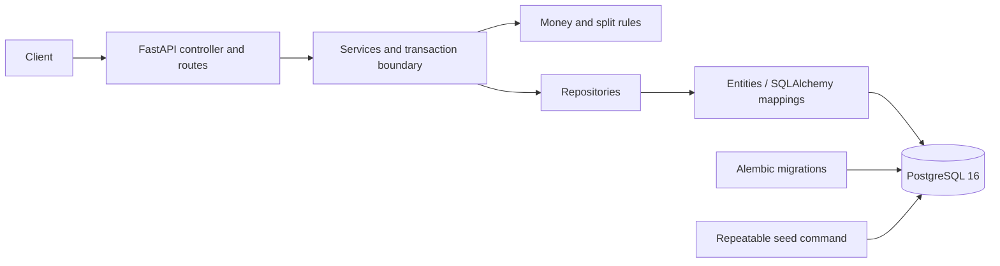

# Backend architecture proposal

Status: this proposal records the original entity–repository–service–controller decision. The current file-level layout and rationale are in [Backend module architecture](BACKEND-MODULE-ARCHITECTURE.md). This structure is the user's choice, not a naming convention mandated by the PDF.

## Problem

The brief requires FastAPI, PostgreSQL 16, Alembic and separation of routing, business rules and data access. It also requires the submitted repository to contain `backend/` and `frontend/` source directories (page 4). It does not prescribe the directories inside `backend/` or a named architecture. The current repository is a backend-only repository with `app/` at its root; whether and how it will be combined with the frontend to satisfy that submission layout remains a separate decision. The six product routes use `/groups` per the approved contract, alongside `/api/health`.

## Usage: caller's view

```python
# Conceptual controller code, not an implementation.
actor = identity_service.identify(x_user)
result = expense_service.create(actor, group_id, key, validated_draft)
# Map result.created to 201 or 200; serialize money as strings.

balances = group_service.get_balances(actor, group_id)  # includes every member
expense_service.delete(actor, group_id, expense_id)  # successful HTTP response: 204
```

The controller defines FastAPI routes and adapts HTTP inputs/outputs. Services own authorization, operation ordering, transaction boundaries, and calls to allocation rules and repositories. Repositories own queries; entities map persisted records and constraints. Service operations do not take FastAPI request models.

## Proposed structure

```text
app/
  main.py                     # app setup, register routers and error handlers
  api/
    routes/health.py          # existing /api/health
    controllers/              # FastAPI APIRouter endpoints: groups, expenses, balances
    schemas.py                # request/response JSON models
    errors.py                 # consistent error envelope and HTTP mappings
  core/
    config.py                 # existing environment settings
    database.py               # engine and session factory
  domain/
    money.py, splits.py       # Decimal validation and pure split allocation
    types.py                  # commands, results, identifiers and domain errors
  services/                   # identity, group and expense use cases / transactions
  repositories/               # group and expense SQL queries; no commits
  entities/                   # SQLAlchemy entities/tables and database constraints
  seed.py                     # separate, repeatable seed command
migrations/                   # Alembic environment and versioned migrations
tests/
  unit/                       # allocation and money edge cases
  integration/                # HTTP + isolated PostgreSQL, including races
```

Controllers define their FastAPI `APIRouter` endpoints directly, so there is no second pass-through route layer. The unused empty `app/models` marker was removed in favor of `app/entities` as the sole persistence mapping location. Consult the actual source tree for implemented module names; the diagram is a design sketch.



## Data and ownership

- **User**: stable ID and unique username. `X-User` identifies a seeded user; it is not real authentication.
- **Group** and **membership**: memberships link users to groups. A membership pair is unique and supports both group lookup and authorization.
- **Expense**: group, payer, description, amount, creation time, deletion marker and nonempty idempotency key. Enforce `UNIQUE (group_id, idempotency_key)` across active and deleted expenses.
- **Share**: expense, group/member and amount. Enforce one share per member per expense. Composite foreign keys can prevent a payer or participant from belonging to a different group; a composite expense key is needed if share rows also store group ID.
- Store each expense/share as `NUMERIC(12,2)`; allow stored zero shares because equal splits can generate them. Exact split shares must be positive. Share totals and cross-row zero-sum properties are validated by the domain operation, with all expense and share writes in one transaction.
- Balances are **derived**, not separately stored: active expense payer credits minus active participant shares. Aggregate credits and shares independently before joining them to all group members, avoiding multiplication from joins. Use a single SQL statement or an explicitly consistent snapshot. Do not constrain an aggregated balance to the per-expense column's precision; totals can exceed one expense's range.

## Business operations and transaction design

The service interfaces conceptually expose `identify`, `list_groups`, `get_group`, `create`, `list`, `delete`, and `get_balances`. The implementation can use typed commands/results; avoid generic CRUD interfaces or a separate unit-of-work abstraction unless an actual need emerges. Inject a session factory, not a long-lived shared session. A single service operation owns its transaction; repositories do not commit independently.

For create:

1. Validate identity and group access; a nonmember receives 404 without expense disclosure. Validate the request body and participant memberships before resolving an existing key. An invalid replay returns 400; a different **valid** body with the same group/key returns the original.
2. Convert money only after checking the wire value is a string, finite, positive where required, within range and has at most two decimal places. Equal split uses integer satang and `divmod`, assigning remaining satang in the requested order. Exact shares are positive and must sum exactly to the expense.
3. In one PostgreSQL `READ COMMITTED` transaction, insert the expense using the unique group/key constraint and `ON CONFLICT DO NOTHING RETURNING`. The winner inserts all shares and commits atomically. A conflicting request waits; after the winner commits, a **new SQL statement** reads the original expense and shares, including soft-deleted ones. If the winner rolls back, another request can insert. Avoid an in-memory lock, pre-check-only logic, or an insert/select in one statement whose snapshot may not see the concurrent winner.
4. Return 201 for the winner and 200 for a valid replay. Any group member may replay; replay never restores a deleted expense. The system must not disclose an expense to a nonmember.

For deletion, check group access, lock or atomically condition the active expense update, enforce payer-only access, and mark it deleted. Only one concurrent delete succeeds; an already-deleted expense returns 404. Active lists and balances exclude deleted rows, while replay deliberately includes them. List by creation time descending, then expense ID descending.

**Validation ordering risk:** FastAPI's automatic body validation can run before a route's group-access check. Design and test the actual dependency/handler flow so nonmembers do not discover a group or expense through replay; an authorized invalid replay still returns 400. Do not rely on a code sketch alone to establish this behavior.

## Alternatives and synthesis

- **Entity–repository–service–controller (selected by user):** controllers → group/expense services → repositories → entities. Fits the existing scaffold and the requested vocabulary; services must keep transaction and authorization decisions cohesive rather than leaking them into controllers or repositories.
- **Feature-oriented ledger:** a cohesive group-ledger capability with feature-local rules and SQL store. It was the initial synthesis recommendation, but the user chose the more familiar layered structure.
- **Event sourcing / CQRS:** provides an event history but introduces projections and operational complexity not needed for the brief's synchronous API or soft-delete requirement.

Two independent sketches were reviewed against requirement fidelity, concurrency, interface depth, proportionality and testability. After reviewing the alternatives, the user selected the layered candidate's structure. Keep its explicit composite-key constraints and incorporate the feature-oriented candidate's cohesive transaction ownership and race handling. The comparison is design review, not proof of implementation.

## Testing and incremental delivery

Use HTTP integration tests with a **separate PostgreSQL test database**, migrations and deterministic seed lifecycle. Exercise the six required cases and user-approved edge cases. For concurrent keys use independent requests; assert one stored expense and consistent original responses, including replay after deletion. Test group-access precedence, simultaneous deletes, stable sorting, range/precision and balances after deletion. Consult the test suite for exact coverage; winner-rollback behavior and focused standalone unit tests remain possible extensions.

Follow the approved ticket sequence in [BACKEND-TICKETS.md](BACKEND-TICKETS.md): group reads and isolated test setup first, then create/equal split and transactional idempotency, then exact split, balances and list/delete, followed by full integration and documentation. Check whether parallel slices affect the same shared service or repository code before running them concurrently.

## Open implementation choices

- Final response shapes for groups, balances and `shares` remain to be specified within the approved object/array and string-money conventions.
- Choose how the isolated test database is provisioned and refuse unsafe use of the development database.
- Define the repeatable seed command's behavior if a username already exists under a conflicting ID; do not overwrite user data or rewind sequences.
- Settings and development Compose use port 5433 by default; deployments can override `DATABASE_URL`.
- If future features allow changing group membership, revisit authorization/transaction locking; membership mutation is outside the current brief.
