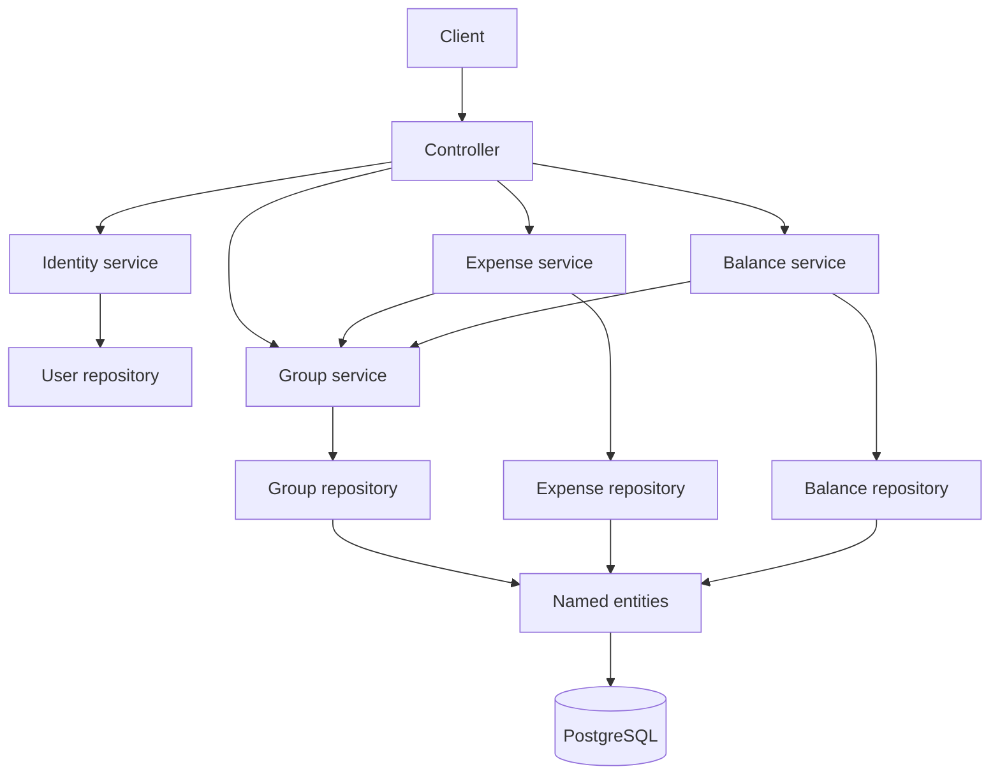

# Backend module architecture

The backend keeps the controller, service, repository, and entity layers the user selected. Each file now has one named domain responsibility, so developers can find the code for a table or operation without opening a mixed module.

## Problem

The PDF requires clear separation between routing, business rules, and data access. It does not prescribe internal folder names. The user selected the entity, repository, service, and controller layers. The current code had five SQLAlchemy mappings in `app/entities/models.py`, user lookup inside group modules, and balance work inside group and expense modules.

## Usage

Controllers call the service that owns the operation:

```python
# app/api/controllers/groups.py
actor = identity.identify(session, x_user)
return groups.list_for_user(session, actor.id)

# app/api/controllers/balances.py
actor = identity.identify(session, x_user)
return balances.get_balances(session, actor.id, group_id)

# app/api/controllers/expenses.py
actor = identity.identify(session, x_user)
return expenses.create(session, actor.id, group_id, idempotency_key, body)
```

Seed code imports each persisted type from its own module. Alembic imports one registry that loads all mappings before reading their shared metadata.

## Shape

```text
app/
  api/
    controllers/
      groups.py       # list and inspect groups
      expenses.py     # create, list, and delete expenses
      balances.py     # read group balances
  entities/
    base.py           # one SQLAlchemy DeclarativeBase
    user.py           # User -> users
    group.py          # Group -> groups
    membership.py     # Membership -> memberships
    expense.py        # Expense -> expenses
    share.py          # Share -> shares
    registry.py       # register mappings for Alembic
  repositories/
    users.py          # find a user by username
    groups.py         # group and membership-scoped queries
    expenses.py       # expense and share persistence
    balances.py       # active payer-credit and share-debit query
  services/
    identity.py       # resolve X-User
    groups.py         # group access, list, and detail
    expenses.py       # expense rules and transactions
    balances.py       # authorize and format balances
  seed.py             # repeatable seed command
migrations/
  env.py              # read entities.registry.metadata
  versions/
    0001_initial.py   # existing schema migration
```

The entity layer contains one ORM mapping per database table. `Membership` links users and groups. `Expense` records the payer and amount. `Share` records each participant's portion. All mappings inherit from the single `entities.base.Base`.

`entities.registry` imports all five mapping modules and exposes `Base.metadata` to Alembic. Normal application code imports a mapping from its own module. `entities/__init__.py` does not re-export every mapping.

Repositories group SQL by the operation that owns it. Group and membership reads stay together because group access depends on membership. Expense and share writes stay together because the service commits them in one transaction. Balance queries have their own repository because they aggregate active expenses and shares. A balance is derived data, so it has no ORM entity.

Services own policy and transactions. `identity.py` resolves `X-User`. `groups.py` checks membership and returns group data. `expenses.py` validates splits, handles idempotency, and commits the expense with its shares. `balances.py` checks group access and formats the derived amounts. Controllers adapt HTTP requests and responses.

Use these service interfaces when adding a route or operation:

```python
def identify(session: Session, username: str | None) -> User: ...
def authorize(session: Session, actor_id: int, group_id: int) -> Group: ...
def create(
    session: Session, actor_id: int, group_id: int, key: str | None, body: object
) -> tuple[dict, bool]: ...
def get_balances(session: Session, actor_id: int, group_id: int) -> list[dict]: ...
```

Each service calls repositories for SQL. `expenses.create` keeps expense and share writes inside one session and one commit. No service passes FastAPI request objects to another layer.

## Data flow



## Contracts to preserve

- Keep all six `/groups` API routes, response fields, error bodies, and status codes unchanged.
- Keep `Decimal`, `NUMERIC(12,2)`, satang allocation, exact-split validation, and zero-sum balances unchanged.
- Keep identity and group authorization before parsing an expense body.
- Read the bounded request body before opening the database session.
- Commit an expense and its shares in one transaction. Keep the group-scoped idempotency constraint and concurrent replay behavior.
- Keep composite foreign keys, unique constraints, check constraints, soft deletion, and the existing migration DDL unchanged.
- Update every caller when a module moves. Do not keep `models.py` as a compatibility import path.

## Synthesis decision

The layer-first candidate is the base. It keeps the ERSC structure the user selected and makes each entity and operation visible in its own file. The feature-first candidate grouped all layers under `groups`, `expenses`, and `balances`. We rejected it because current operations cross those features, so it adds another package hierarchy and more cross-feature imports.

The candidates were scored against the same criteria. Scores use a five-point scale.

| Criterion | Layer-first | Feature-first |
| --- | ---: | ---: |
| Matches the user's selected ERSC layout | 5 | 2 |
| Makes entity and operation ownership easy to find | 5 | 4 |
| Keeps common call paths and dependencies short | 5 | 3 |
| Preserves transactions and database invariants | 5 | 5 |
| Fits the current backend's size | 4 | 3 |
| **Total** | **24/25** | **17/25** |

The layer-first design adopts the useful feature candidate insight that balances deserve an explicit read path. It also separates identity lookup from group reads. It keeps `Membership` queries with groups and `Share` writes with expenses, rather than adding pass-through repositories for every table. This follows Model the Domain, Boundary Discipline, and the Laziness Protocol.

The issue and PR history records the ERSC choice but no reason for putting all five mappings in one file. The initial database commit imported `Base` from `models.py` in Alembic, so that import also loaded all mappings. The history supports that as a possible convenience, not as a recorded design requirement. See [Issue #1](https://github.com/ADISAK-PORNCHAROEN/splitbill-backend/issues/1), [PR #9](https://github.com/ADISAK-PORNCHAROEN/splitbill-backend/pull/9), and [the original architecture proposal](BACKEND-ARCHITECTURE-PROPOSAL.md).

Two independent design candidates were compared. Both used one shared `Base`, an explicit Alembic registry, one entity per mapping, and no `Balance` entity. No graft was needed. A cross-family judge was unavailable in this environment, so the final selection uses the stated criteria and the user's earlier ERSC decision.

## Alternatives considered

- **Feature-first packages:** group each feature's controller, service, repository, and entities together. This can help when features have few cross-dependencies. Here, expense and balance operations both depend on group membership, so the extra feature boundary would lengthen common call paths.
- **One repository per table:** split membership and share SQL into dedicated repositories. This would separate group authorization queries from group reads and expense shares from their transaction. Those modules would mostly forward single operations without hiding policy.
- **Keep the combined files:** comments could label every mapping, but readers would still open one file for unrelated table definitions. That does not solve the lookup problem.

## Risks and future changes

When a developer adds a mapped entity, they must import it in `entities.registry` before Alembic reads `Base.metadata`. Keep the registry explicit. If the product adds invites or member removal, revisit membership operations and authorization locking together.
